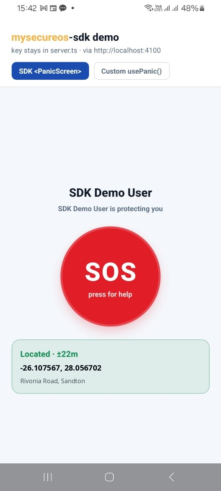
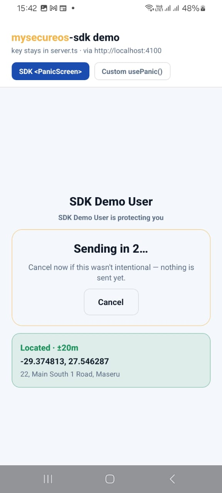
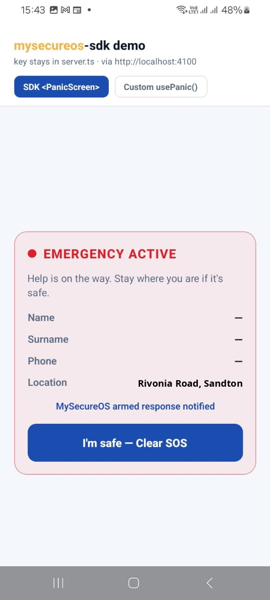
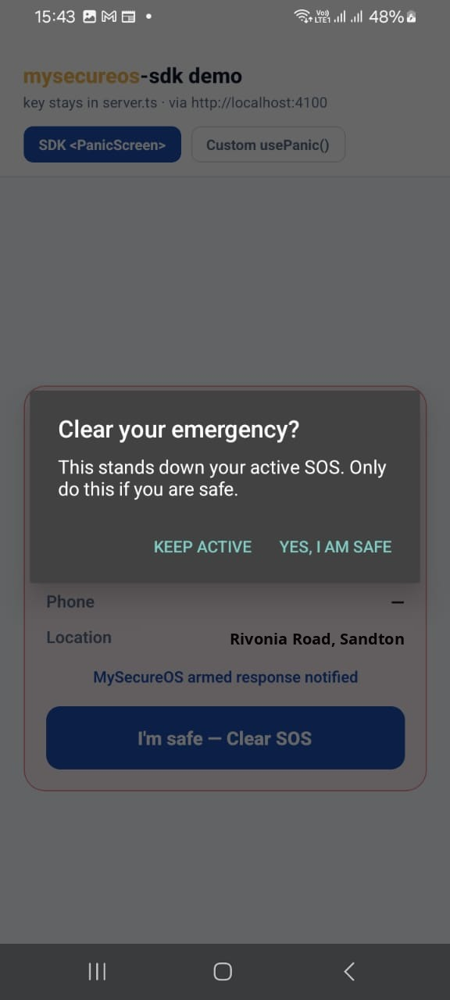
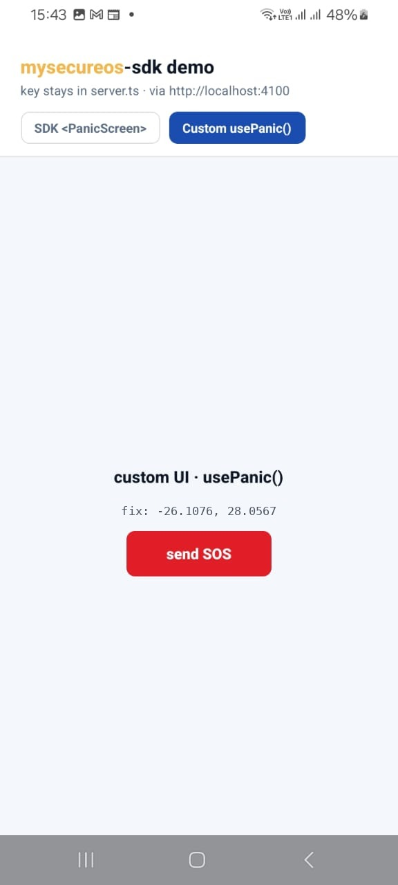
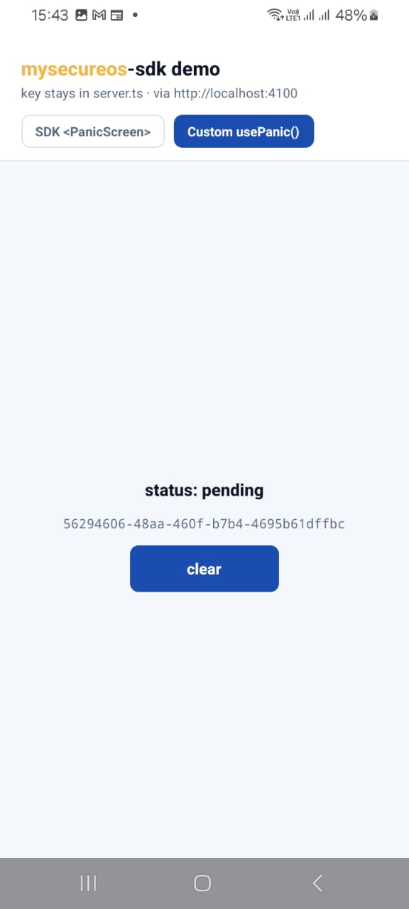
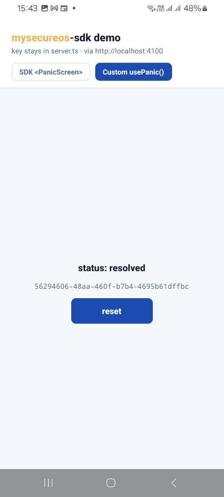

# mysecureos-sdk-demo-mobile

A real, installable Expo/React Native app (not Expo Go, not a web page)
demonstrating the trusted-partner flow. It activates a test emergency (with
a 5-second cancel window before it's actually sent) and clears it with a
reason.

The app itself holds **no API key at all**  that's the point. A
trusted-partner API key is a server secret; shipping it inside a phone
app bundle would let anyone who decompiles the APK read it out. Instead,
`server.ts` in this same project is a small standalone server that holds
the key (from `.env`) and calls `mysecureos-sdk`'s `MySecureOSPartnerClient`
on the app's behalf  the Expo app (`App.tsx`) only ever talks to *that*
server's two plain endpoints, over `fetch`, with no key involved.

## Screenshots

Running on a physical Android device, against the local dev API.

### Mode 1  the SDK's `<PanicScreen>`

The whole MySecureOS panic UI as one component (`location`, `subject`,
`confirmSeconds`, `backend`).

| Idle | 5s cancel window | Emergency active | Clear confirm |
| --- | --- | --- | --- |
|  |  |  |  |

### Mode 2  a custom UI on `usePanic()`

Same hook state (`active`, `fix`, `sending`, `activate`, `clear`, …),
a deliberately plain layout to show the UI isn't locked to the SDK.

| Idle | Pending | Resolved |
| --- | --- | --- |
|  |  |  |

## Setup

```bash
npm install
cp .env.example .env
```

Edit `.env`:

- `MYSECUREOS_BASE_URL`  the MySecureOS API `server.ts` forwards to
  (defaults to the local dev API, `http://localhost:4000`).
- `MYSECUREOS_API_KEY`  a trusted-partner key, generated from the tenant
  dashboard's Settings > API Keys (`http://localhost:3000/tenant/settings`,
  log in as `admin@mysecureos.co.za` / `mysecureos-dev-only`). Shown once,
  at creation. `.env` is gitignored  never commit a real key.
- `PORT`  what `server.ts` listens on (defaults to `4100`; the app's
  `EXPO_PUBLIC_PROXY_URL` should match).

`mysecureos-sdk` is installed from the sibling `../mysecureos-sdk`
checkout. This project's `.npmrc` sets `install-links=true` so it's copied
in rather than symlinked  a plain symlink would resolve the SDK's
`import ... from 'react'` against the *SDK repo's own* `node_modules/react`
(needed there for its own build/tests) instead of this project's copy,
producing two separate React instances and an "Invalid hook call" error.

If you change the SDK's source, rebuild it and reinstall here:

```bash
(cd ../mysecureos-sdk && npm run build)
npm install
```

## Run on a physical Android device over USB

### 1. Start the local backend

By default `server.ts` talks to the **local dev API**, not the hosted
production one, so activated emergencies land in your local `emergencies`
table instead of production data. From the `mysecureos` monorepo root:

```bash
cd ../mysecureos
pnpm db:up                          # Postgres + PostGIS + TimescaleDB via docker
pnpm --filter @mysecureos/api dev   # API on :4000
pnpm --filter @mysecureos/web dev   # web dashboard on :3000
```

Generate a trusted-partner API key as described in [Setup](#setup) above,
and put it in this project's `.env`.

### 2. Start server.ts

```bash
npm run server   # listens on :4100
```

Keep this running alongside the Expo app  it's a separate Node process,
not part of the Metro/Expo bundle.

### 3. Connect the phone

1. Enable USB debugging on the phone (Developer Options) and plug it in.
2. Accept the "Allow USB debugging?" prompt on the device  `adb devices`
   should show it as `device`, not `unauthorized`.

### 4. Build and install

```bash
npx expo run:android
```

This builds, installs, and launches the app on the connected device, and
starts the Metro bundler. **First run does a full native build** (Gradle +
NDK/CMake)  this can take a long time depending on network speed, since it
has to download large native dependencies (e.g. the `react-android` AAR,
which alone is ~279 MB). Later runs reuse the Gradle cache and are much
faster (a manifest-only or JS-only change rebuilds in well under a minute).

To avoid an unnecessarily slow rebuild, scope it to the device's actual
architecture instead of building all four:

```bash
adb shell getprop ro.product.cpu.abi   # confirm, e.g. arm64-v8a
cd android && ./gradlew app:assembleDebug -PreactNativeArchitectures=arm64-v8a
adb install -r app/build/outputs/apk/debug/app-debug.apk
```

### adb reverse tunnels

Same pattern as the `mysecureos` monorepo's `apps/mobile` (see its root
`README.md`): the app reaches Metro (`:8081`) and `server.ts` (`:4100`)
through `adb reverse` tunnels. `expo run:android` sets up `:8081`
automatically, but `:4100` needs to be added manually. (No tunnel is
needed for `:4000`  `server.ts` runs on your dev machine and reaches the
MySecureOS API directly over `localhost`; the phone never talks to it.)
Neither tunnel survives a USB reconnect, phone reboot, or `adb` server
restart  if the app hangs on the splash screen or a request fails,
re-create both and reopen the app:

```bash
adb reverse tcp:8081 tcp:8081   # JS bundle (Metro)
adb reverse tcp:4100 tcp:4100   # server.ts
```

### If the app disappears from the phone

The installed app can get removed independently of this project (e.g. a
manual uninstall while testing). Since the APK doesn't change unless native
code, `app.json`, or the manifest changed, you don't need a full rebuild 
just reinstall and relaunch:

```bash
adb install android/app/build/outputs/apk/debug/app-debug.apk
adb reverse tcp:8081 tcp:8081
adb reverse tcp:4100 tcp:4100
adb shell am start -n com.mysecureos.sdkdemo/.MainActivity
```

### Environment

```bash
EXPO_PUBLIC_PROXY_URL=http://localhost:4100 npx expo run:android
```

Omit to default to that same URL  only worth overriding if you run
`server.ts` on a different port.

### Troubleshooting: cleartext (plain HTTP) traffic blocked

Android blocks plain `http://` requests by default, which would break
`server.ts` (`http://localhost:4100`, no TLS). `app.json` sets
`android.usesCleartextTraffic: true` for this, and it's also hand-patched
into the already-generated `android/app/src/main/AndroidManifest.xml`
(`android:usesCleartextTraffic="true"` on `<application>`)  if you ever
regenerate `android/` with `expo prebuild --clean`, re-apply that manifest
attribute, since a plain `app.json` change won't retroactively update an
already-generated manifest.

### Troubleshooting: Gradle build hangs/crashes with a Kotlin isolation error

If `expo run:android` fails with `Could not isolate parameters ...
BuildToolsApiClasspathEntrySnapshotTransform` (a Kotlin Gradle plugin bug
under parallel execution), `android/gradle.properties` already has a
workaround applied:

```properties
kotlin.compiler.execution.strategy=in-process
org.gradle.parallel=false
```

This trades build speed for avoiding the crash. If your machine doesn't
hit this bug, removing these two lines restores normal parallel builds.

## What it shows

- The right place for a trusted-partner API key: on a server (`server.ts`),
  never in a phone app. `App.tsx` only knows that server's URL  it has no
  concept of `mysecureos-sdk`'s `MySecureOSPartnerClient` or any API key at
  all, just two plain `fetch` calls to `server.ts`'s own small API
  (`POST /emergencies/activate`, `POST /emergencies/:id/clear`).
- `server.ts` itself is the one place `MySecureOSPartnerClient` is used,
  loading `MYSECUREOS_BASE_URL`/`MYSECUREOS_API_KEY` from `.env`.
- `App.tsx`'s `EmergencyScreen` adds a 5-second confirm countdown in front
  of activating (cancelling during it never calls `server.ts` at all  no
  emergency is created), and always sends a reason when clearing an
  already-active one.
- The phone's real GPS location (`expo-location`) is captured automatically
  right when the countdown ends and sent with the activation  there's no
  manual latitude/longitude entry. Permission is requested up front, on
  app launch, not mid-emergency; if it's denied, activation still proceeds
  (`location` is optional server-side), just without coordinates.
